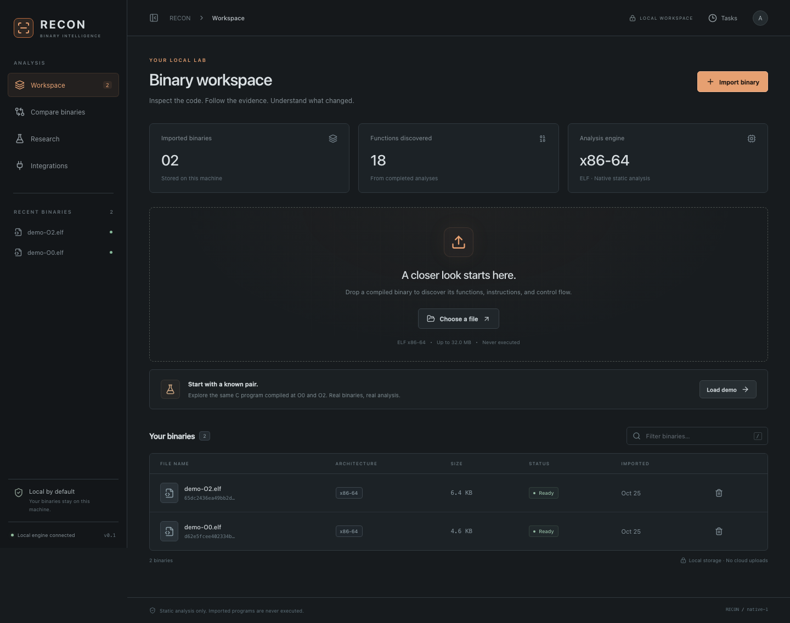

# RECON

RECON is a university project we're building to compare compiled programs and find similar functions. The idea is to see which parts of two programs might match, even when they were built differently.

It runs on your own computer and looks at program files without running them. You don't need a paid AI service to use it.

## What works so far

- Import a program file and browse its functions.
- Look at the instructions and how different parts of a function connect.
- Compare two builds and view possible matches side by side.
- Try the included example programs and download the results.

At the moment, we support 64-bit Linux program files (ELF). Support for other formats is still planned.

## Where we're at

We have an early working version, with tests for importing files, comparing functions, and using the interface.

We've also trained a small machine learning model to try improving the matches. In our first small experiment, the simpler comparison methods did better, so there's still work to do there.

The results are suggestions to investigate. A high score doesn't prove that two functions do exactly the same thing.

## Try it

The [setup guide](docs/SETUP.md) has the commands to run the project. Once it's open, click **Load demo** to try the included examples.

## What's next

- Test with more programs and different builds.
- Improve the matching and check where it gets things wrong.
- Finish testing the optional analysis tools.
- Make the interface easier to use as the project grows.

More detailed notes are in the [docs folder](docs/), including our [progress](docs/PROGRESS.md) and [known issues](docs/KNOWN_ISSUES.md).
