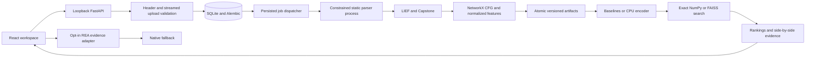

# Architecture

RECON runs as one local API process with one job dispatcher. The browser is a
React/TypeScript application served by FastAPI after a Vite build. In development,
Vite proxies `/api` to the loopback API. There is no paid API dependency.

## Static extraction

Admission accepts little-endian x86-64 ELF executables/shared objects with bounded
conventional section/program tables. The target bytes are data, never an executable
command. The worker enforces wall-clock, CPU, memory and output budgets. macOS adds
sandbox network/write denial; see the threat model for platform boundaries.

LIEF supplies sections, imports and symbol entries. Symbol-backed boundaries retain
their provenance. Missing boundaries use a conservative entry/direct-call fallback,
with explicit lower confidence and limitations. Capstone decodes instructions;
NetworkX represents blocks, conditional branch/fallthrough edges and graph metrics.
Indirect jumps and exception edges remain unresolved.

## Persistence and failure behavior

SQLite stores binaries, function summaries, jobs, comparisons and experiments with
foreign keys. Large instruction lists and reports live in hashed JSON artifacts.
Files use fsync plus atomic replacement. Jobs persist phase/error state; service
restart marks interrupted running tasks as failed and resumes queued work.

One API process/dispatcher is supported per data directory. Do not run multiple
servers or concurrent CLI trainers against the same directory. Cancellation is
cooperative for comparisons/training and kills the parser process group for analysis.
Deletion is refused while dependent jobs are active. Derived comparison/index/evidence
files are removed with their binary. Reanalysis invalidates dependent comparisons/indexes.

## Features and inference

The feature schema is `x86-tokens-cfg-1`. Register classes, branch destinations,
memory operands and constants are normalized. Source names, labels, addresses,
compiler flags and debug data never enter the matching vectors.

Baselines combine opcode cosine, candidate-fitted TF-IDF n-grams and log structural
distance. The combined score weights are 0.4/0.4/0.2, fixed before evaluation.
Neural inference uses 64-dimensional normalized embeddings. Compatible candidate
vectors persist locally; FAISS exact inner-product search is used when installed,
with NumPy exact search as fallback. Inference models are cached separately from
mutable training models. Index manifests bind schema, model version and candidate
hashes. Changes require a compatible new index.

## Research and evidence providers

Research is separate from Analysis Mode. Dataset compilation only runs trusted,
pinned source builds, and never runs their output. DWARF entry addresses and source
symbols establish labels. Project splits precede pair creation. The tokenizer uses
training projects only; validation selects weights; test projects are evaluated later.

The REA adapter implements a provider contract and preserves the complete raw
Evidence record alongside normalized provenance. Provider failures return genuine
native evidence. REA prose does not affect embeddings or similarity scores. No
external AI narrative provider is configured. Direct Ghidra-only integration and
real REA end-to-end verification remain follow-up work.
